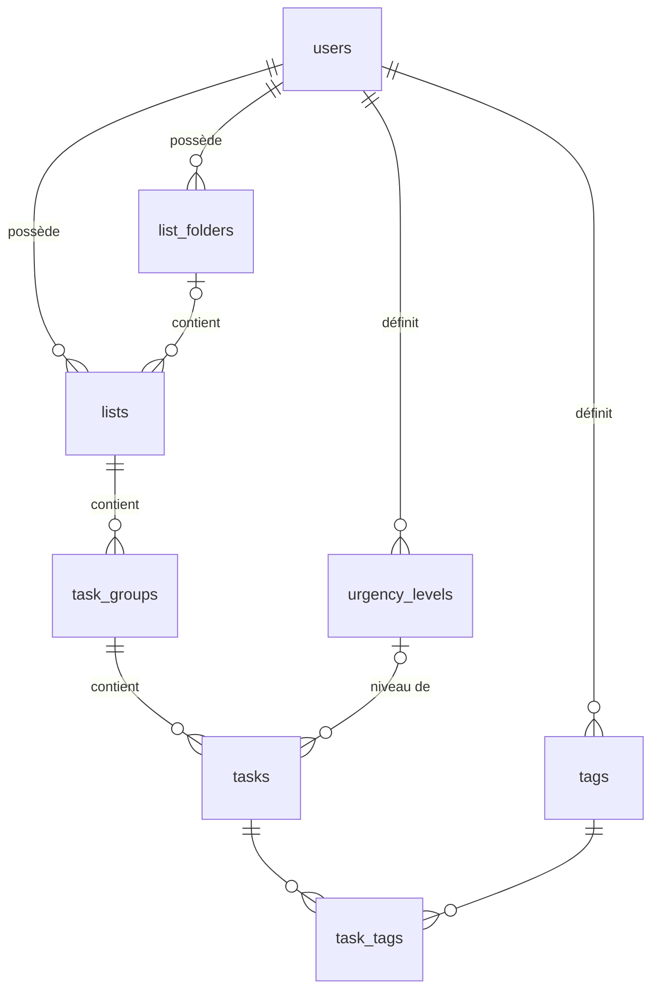

# Étape 1 : base de données PostgreSQL

> **Mis à jour à l'étape 2a :** le schéma n'est plus dans `db/init/01-schema.sql`, mais dans `api/migrations/001_schema.sql`. C'est le serveur API qui le crée au démarrage. Voir [02a-api-fondations.md](02a-api-fondations.md). Le reste de ce document (modèle de données, choix, exploration avec psql) reste valable.

## Objectif

Mettre en place la base de données de BetterTodo dans Docker, avec toutes les tables nécessaires pour la maquette : comptes, groupes de listes, listes, groupes de tâches, tâches, niveaux d'urgence et tags.

À la fin de cette étape, il n'y a encore ni API ni page web. On peut seulement démarrer la base et l'interroger en SQL.

## Fichiers

```
docker-compose.yml        → décrit le conteneur "db" (PostgreSQL 17)
.env.example              → modèle des variables (nom de la base, utilisateur, mot de passe)
.env                      → TA copie avec le vrai mot de passe (jamais commitée)
db/init/01-schema.sql     → création des tables, lancée automatiquement au 1er démarrage
db/exemple/exemple.sql    → données de la maquette, à charger à la main
```

## Comment ça marche

### Le conteneur

`docker-compose.yml` lance l'image officielle `postgres:17-alpine` avec :

- **un volume `db-data`** : les données sont stockées en dehors du conteneur. On peut arrêter, supprimer ou mettre à jour le conteneur sans perdre ses tâches ;
- **le dossier `db/init/`** monté dans `/docker-entrypoint-initdb.d`. Au **tout premier** démarrage (volume vide), PostgreSQL exécute les fichiers `.sql` de ce dossier, dans l'ordre alphabétique ;
- **le port `127.0.0.1:5432`** : la base n'est joignable que depuis ta machine, pas depuis le réseau. Ça sert à l'inspecter pendant le développement. Plus tard, l'API y accédera par le réseau interne de Docker ;
- **un healthcheck** (`pg_isready`) : Docker sait quand la base est vraiment prête. L'API pourra attendre ce signal avant de démarrer.

### Le modèle de données



| Table | Ce que c'est |
|---|---|
| `users` | Un compte. L'email est unique et toujours en minuscules. On ne stocke que le **hash** du mot de passe. |
| `list_folders` | Un groupe de listes de la barre latérale (« Personnel »…). `collapsed` retient s'il est replié. |
| `lists` | Une liste, avec sa couleur (`#RRGGBB`), son icône Lucide (par son nom, ex. `briefcase`) et sa vue par défaut (`columns` ou `sections`). |
| `task_groups` | Un groupe de tâches dans une liste (« Courses »…), c'est-à-dire une colonne de la vue colonnes. |
| `tasks` | Une tâche : titre, notes, échéance (`due_date`), urgence, cochée ou non. |
| `urgency_levels` | Les niveaux d'urgence propres à chaque utilisateur. `rank` donne l'ordre (0 = le moins urgent). |
| `tags`, `task_tags` | Les tags d'un utilisateur, et la table de liaison qui dit quelle tâche a quel tag. |

### Les choix et leurs raisons

- **Identifiants en UUID** (`gen_random_uuid()`) plutôt que 1, 2, 3… Une app hors ligne pourra créer une tâche avec son propre identifiant sans risquer de collision avec le serveur.
- **`position`** sur les listes, groupes et tâches : c'est l'ordre d'affichage. Pour un glisser-déposer, il suffit de mettre à jour les positions.
- **`updated_at` mis à jour automatiquement** par un trigger (`set_updated_at()`), sans que l'API ait à y penser. Ça servira à la synchronisation : « donne-moi tout ce qui a changé depuis telle date ».
- **Suppressions en cascade (`ON DELETE CASCADE`)** : supprimer une liste supprime ses groupes et ses tâches. Supprimer un utilisateur supprime tout ce qui lui appartient.
- **Deux exceptions (`ON DELETE SET NULL`)** :
  - supprimer un **groupe de listes** ne supprime pas ses listes : elles se retrouvent « hors groupe » ;
  - supprimer un **niveau d'urgence** laisse les tâches sans urgence.
- **Contrôles (`CHECK`)** : couleur au format `#RRGGBB`, email en minuscules, vue `columns` ou `sections`. Une valeur invalide est refusée par la base elle-même.
- **Index sur les clés étrangères** : PostgreSQL ne les crée pas tout seul. Sans eux, « toutes les tâches de ce groupe » deviendrait lent avec beaucoup de données.

> **À savoir :** la base ne vérifie pas qu'une tâche utilise un niveau d'urgence **du même utilisateur**, ni qu'une liste est rangée dans un groupe de listes **du même utilisateur**. C'est l'API (étape 2) qui fera ces contrôles. On garde ainsi un schéma simple.

## Lancer la base

1. Démarrer Docker Desktop.
2. Créer le fichier `.env` (une seule fois) et y mettre un vrai mot de passe :
   ```bash
   cp .env.example .env
   ```
3. Démarrer la base (`--wait` attend qu'elle soit prête) :
   ```bash
   docker compose up -d --wait
   ```
4. Charger les données d'exemple de la maquette :
   ```bash
   docker compose exec -T db sh -c 'psql -U "$POSTGRES_USER" -d "$POSTGRES_DB"' < db/exemple/exemple.sql
   ```
   Le compte de démo est indiqué en tête du fichier `db/exemple/exemple.sql`.

## Explorer la base

Ouvrir une console SQL dans le conteneur :

```bash
docker compose exec db sh -c 'psql -U "$POSTGRES_USER" -d "$POSTGRES_DB"'
```

Quelques commandes utiles dans `psql` :

| Commande | Effet |
|---|---|
| `\dt` | liste les tables |
| `\d tasks` | décrit la table `tasks` (colonnes, contraintes, index) |
| `\q` | quitte |

Exemple : les tâches de la liste « Perso », avec leur groupe et leur urgence.

```sql
SELECT g.name AS groupe, t.title, t.due_date, u.name AS urgence, t.done
FROM tasks t
JOIN task_groups g ON g.id = t.group_id
JOIN lists l       ON l.id = g.list_id
LEFT JOIN urgency_levels u ON u.id = t.urgency_id
WHERE l.name = 'Perso'
ORDER BY g.position, t.position;
```

Avec un client graphique (TablePlus, DBeaver, pgAdmin…) : hôte `127.0.0.1`, port `5432`, et la base, l'utilisateur et le mot de passe de ton `.env`.

## Repartir de zéro

Pour tout effacer et rejouer `01-schema.sql` (par exemple après l'avoir modifié) :

```bash
docker compose down -v
```

puis refaire les étapes 3 et 4 de « Lancer la base ». Le `-v` supprime le volume, donc **toutes les données**.

## Ce qui a été testé

- Le schéma se crée sans erreur au premier démarrage.
- Les données d'exemple se chargent : 7 listes dans 3 groupes de listes, 14 tâches avec urgences et tags.
- Le mot de passe de démo est bien vérifiable avec son hash bcrypt.
- `updated_at` change bien lors d'un `UPDATE`.
- Une couleur invalide (`rouge`) et un email avec majuscules sont refusés.
- Supprimer une liste supprime ses tâches. Supprimer un groupe de listes garde ses listes, hors groupe.

## En cas de problème

| Symptôme | Cause probable | Solution |
|---|---|---|
| `failed to connect to the docker API` | Docker Desktop n'est pas lancé | Le démarrer, attendre qu'il soit prêt |
| `port is already allocated` sur 5432 | Un autre PostgreSQL tourne déjà sur ta machine | L'arrêter, ou changer `127.0.0.1:5432` en `127.0.0.1:5433:5432` dans `docker-compose.yml` |
| Une modif de `01-schema.sql` n'a aucun effet | Les scripts d'init ne tournent qu'avec un volume vide | `docker compose down -v`, puis relancer |
| `password authentication failed` après avoir changé `.env` | Le mot de passe est fixé au premier démarrage, dans le volume | `docker compose down -v` (efface les données), ou changer le mot de passe avec `ALTER USER` |
| `duplicate key … users_email_key` en chargeant l'exemple | Les données d'exemple sont déjà chargées | Rien à faire, ou repartir de zéro |
| Voir ce que fait la base | — | `docker compose logs -f db` |

## Et après ?

À l'**étape 2**, on ajoutera le serveur API en Go, qui comprendra :
- un deuxième conteneur `api` ;
- l'inscription et la connexion (hash des mots de passe, sessions) ;
- les routes pour créer, lire, modifier et supprimer listes, groupes et tâches ;
- un système de **migrations**, pour faire évoluer le schéma sans effacer la base.
